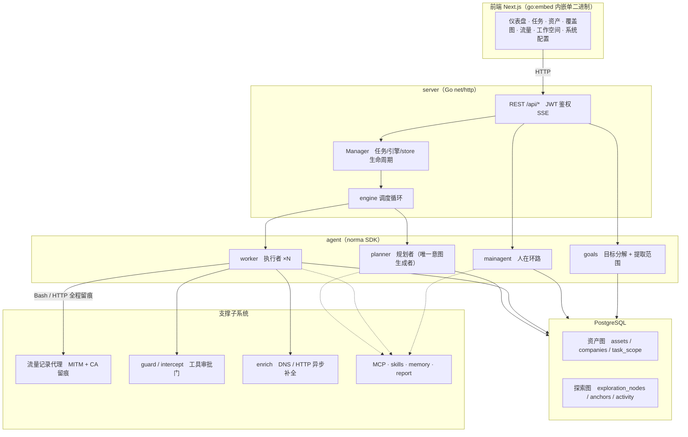
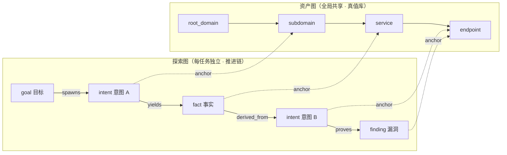
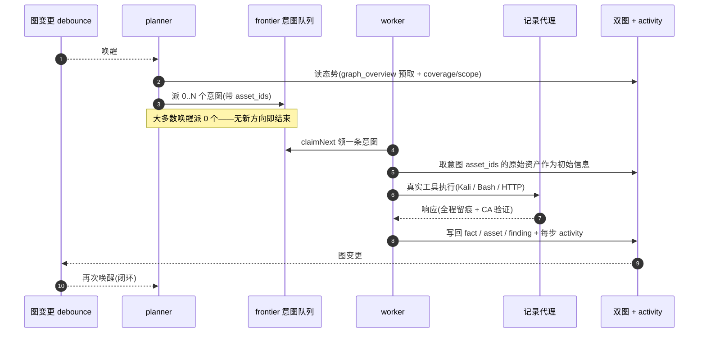
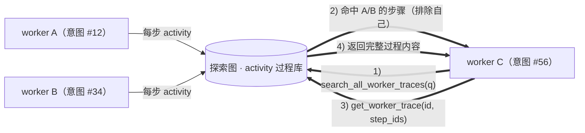
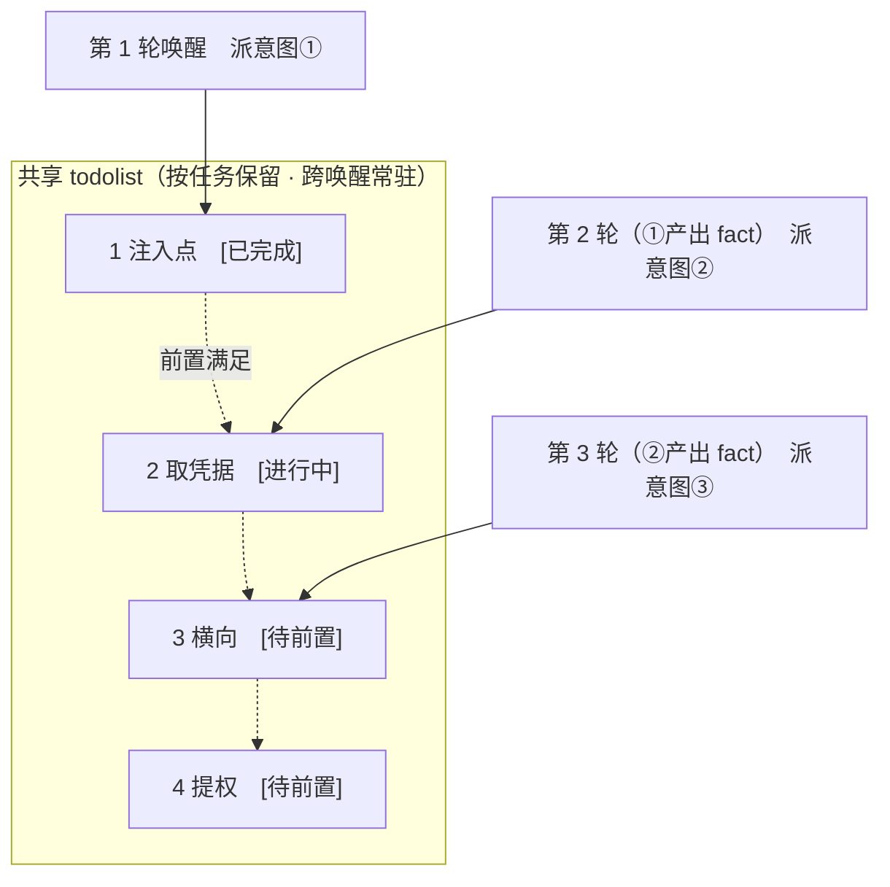

<div align="center">

# ARTEX

AI 自主渗透测试系统（Go 后端 + Next.js 前端）

</div>

---

## 版本与近期更新

本仓库（[7huukdlnkjkjba/ARTEX](https://github.com/7huukdlnkjkjba/ARTEX)）在上游基础上持续二开：

| 版本 | 内容 |
|---|---|
| **v0.3.16** | **deepseek-hermes省钱代码（成本控制）**：单次会话默认 ¥6 封顶，缓存命中按 ¥0.5/M 单独计价、不与输入重复计费，预算余额写进 planner/worker 提示词逼模型收敛，任务详情显示 `≈¥已用 / 上限` |
| **v0.3.17** | 并入artex-ymh能力「外网突破 → 立足点 → 内网纵深」：webshell 会话、penelope 反弹、`session_recon`、suo5/chisel 隧道、内网拓扑、凭据库、待授权网段、任务移交、伪装门控、一键放行、RoE 三态、蜜罐识别、chains 技能、`artex doctor` |
| **v0.3.18** | Metasploit **全自动闭环**（**端到端已验证 2026-10-27**）：确定性决策层 `msf/`、`msf_plan`/`msf_next`/`msf_execute`、自动拉起受管 msfrpcd、内置 MCP 启动、确认后自动派单、会话自动取证并写回 fact；闭环依赖**自动安装**（首次启动检测不到 `mcp-pymetasploit3` 时自动 `pip install`，可关、可指定解释器） |
| **v0.3.19** | **Exploit Author + Vuln Hunter**：Metasploit 无确定性路径的确认漏洞自动转交 `exploit_author` 意图，用 `exploit_init/write/run/verify/abandon` 写出并验证真实 exp；新增 `vulnhunt` 意图与 `vulnhunt_init/build/fuzz/triage/report` 工具，对本地仓库/二进制做 fuzzing、按 sanitizer 栈去重并提升为 finding|
| **v0.3.20** | **WAF 绕过预筛**：新增人工接口 `POST /api/waf-probe`，先识别 WAF 指纹，再把同一条 SQL 注入意图用 8 种编码/变形重放，返回 `bypassable`/`hard`/`skip`、0-100 评分与逐条证据（`server/waf_bypass_probe.go`） |
| **v0.3.21** | **AD 与侦察工具化**：新增 worker 工具 `ad_kerberoast`（Kerberoasting：枚举/定向 TGS、RC4+AES 哈希解析、凭据库/scope/dry-run、finding/fact 回写）与 `scan_rustscan`（RustScan TCP 全端口扫描：结构化开放端口、CIDR 保护、scope、fact 回写）；端口扫描强制走 `scan_rustscan`，执行归代码、决策归 AI |
| **v0.3.22** | **HTTP 黑盒工具化**：新增 worker 工具 `recon_http`（单请求侦察：状态/头/体预览/重定向/超时/错误分类，走任务代理与录制）与 `http_diff`（基线 vs 变体：状态翻转/长度/内容相似度信号，支持 IDOR/越权/注入/认证差异）；HTTP 侦察优先走工具，执行归代码、决策归 AI |
| **v0.3.23** | **证据核心（观察台账 + 闸门 finding）**：新增 `path_probe` / `admin_surface` / `fingerprint` / `auth_probe`，所有探测写入 per-intent `observation_ledger.json`（receipt_id + request/response hash + 完整性）；新增 `report_finding_gated`，只接受台账内、URL 匹配、response_hash 一致的证据，阻止凭印象/版本猜测写 finding |
| **v0.3.24** | **内网原生协议 + AS-REP + DCSync**：新增 `raw_tcp`（SMB2/LDAP/TDS/MySQL/raw hex 原生 TCP 探测，自动走任务隧道 SOCKS5，代码构造与指纹，不做认证/利用）、`ad_asreproast`（T1558.004 AS-REP Roasting）与 `ad_dcsync`（T1003.006，必须显式 confirm，哈希不写 finding evidence） |
| **v0.3.25** | **受控 Web 利用与 impacket 隧道**：新增 `sqlmap_run`（detect/dbs/current-user/is-dba/dump，dump 需 confirm+table）、`nuclei_run`（JSONL 解析、限速、关 interactsh）与 `impacket_proxy`（Linux/proxychains + 任务 SOCKS5，让 impacket 进隔离内网） |

- 内网能力说明：[README-FORK.md](README-FORK.md)、`INTRANET-PIVOT-DESIGN.md`、`HONEYPOT-DETECTION-DESIGN.md`
- Metasploit 闭环：[MSF-CLOSED-LOOP.md](MSF-CLOSED-LOOP.md)
- Exploit Author / Vuln Hunter：见下文「Exploit Author 与 Vuln Hunter（0.3.19）」
- WAF 绕过预筛（`POST /api/waf-probe`）：见下文「WAF 绕过预筛（0.3.20）」
- AD 与端口扫描工具（`ad_kerberoast` / `scan_rustscan`）：见下文「AD 与端口扫描工具（0.3.21）」
- HTTP 黑盒侦察与差分（`recon_http` / `http_diff`）：见下文「HTTP 黑盒侦察与差分（0.3.22）」
- 证据核心（观察台账 / `report_finding_gated`）：见下文「证据核心：观察台账与闸门 finding（0.3.23）」
- 内网原生协议与 AS-REP（`raw_tcp` / `ad_asreproast` / `ad_dcsync`）：见下文「内网原生协议与 AS-REP（0.3.24）」
- 受控 Web 利用与 impacket 隧道（`sqlmap_run` / `nuclei_run` / `impacket_proxy`）：见下文「受控 Web 利用与 impacket 隧道（0.3.25）」
- 成本控制（¥6 会话预算 / DeepSeek 价格表 / 缓存命中计价）：见下文「成本控制（DeepSeek 省钱）」与「省钱小妙招」
- 完整变更：[CHANGELOG.md](CHANGELOG.md)

---

## 截图预览

| 仪表盘（总览 / Token 消耗 / 活动流） | 任务列表 |
| :---: | :---: |
|  |  |

| 任务 · 执行过程（会话 / 工具调用） | 探索链路 |
| :---: | :---: |
|  |  |

| 发现 | 资产 |
| :---: | :---: |
|  |  |

| 资产覆盖图（力导向布局 · 已测高亮 · 节点折叠展开） |
| :---: |
|  |

| 流量录制 | 人在环路对话 |
| :---: | :---: |
|  |  |

| Agent 管理 | LLM 配置 |
| :---: | :---: |
|  |  |

| 拦截审批 | 后端日志 |
| :---: | :---: |
|  |  |


---

## 审批记录详情

全局「审批记录」、任务内「拦截审批」及对话中的审批卡片均支持展开查看详情。展示结构参考
[AegisHook 的审批详情组件](https://github.com/RuoJi6/AegisHook/blob/main/web/src/components/CallDetail.vue)，沿用 ARTEX 的组件和主题：


## 资产同步（ScopeSentry）

支持从 [ScopeSentry](https://github.com/Autumn-27/ScopeSentry) 直接同步资产数据，免去重复收集：

- 在「**资产同步**」页填 ScopeSentry 的地址与 API Key，接入数据源；
- 按**项目**或**任务**维度选择要同步的目标与资产类型（域名 / 子域 / IP / 端口 / 站点 / 端点…）；
- 一键导入并按公司资产范围归并，直接进入 ARTEX 的资产图供 agent 探索使用。

---

## 内网作战（0.3.17 合并自 artex-ymh）

0.3.17 在 0.3.16 主线上并入了二开分支的「外网突破 → 立足点 → 内网纵深」能力，与原有外网
探索共用同一套双图、审批与范围强制：

- **立足点**：PHP/JSP 加密 webshell 会话（注册/心跳/执行/文件读写/探活）、penelope 受管反弹 shell；
- **侦察与隧道**：`session_recon` 被动侦察、suo5/chisel 自动选型与 `tunnel_*` 四件套、
  任务级 MITM 热切换、内网拓扑图；
- **阶段编排**：待授权网段审批扩 scope、外网→内网任务移交、内网期 worker 提示词变体；
- **安全侧**：伪装门控、一键放行、RoE 三态、出口敏感信息审查、蜜罐识别（Cowrie/OpenCanary 等签名）、
  chains 场景化思维链；
- **部署**：`artex doctor` 预检、`packaging/tools-manifest.json` 工具钉版、systemd unit。

细节与部署依赖（chisel / penelope / `ARTEX_CALLBACK_ADDR` 等）见 [README-FORK.md](README-FORK.md)
与 `HONEYPOT-DETECTION-DESIGN.md`、`INTRANET-PIVOT-DESIGN.md`、`CHAINS-INTEGRATION-DESIGN.md`。

> 0.3.17 的认证沿用 0.3.16 的 JWT 模型（未启用 refresh token / SSE ticket），流量代理保留
> 0.3.15 的检索与回收实现。完整变更见 [CHANGELOG.md](CHANGELOG.md)。

---

## Metasploit 全自动闭环（msf）

对接 [mcp-pymetasploit3](https://github.com/daedalus/mcp-pymetasploit3)（Metasploit RPC 的 MCP 封装）。

> **当前状态：端到端已跑通（2026-10-27，本地 Tomcat 7.0.79 靶场）。** 链路：模型侦察 →
> `report_finding` → 自动验证 confirmed → `msfAutoKick` 直接派单 → worker `msf_plan` →
> `msf_execute` → Metasploit 拿到 session → 自动取证写回 fact。任务 #6 用时 3 分 30 秒、¥1.07；
> 任务 #7 复验取证、¥0.86。

**已验证（2026-10-27，任务 #6 / #7）**

- **端到端闭环**：worker 用 `PUT /shell.jsp/` 确认 CVE-2017-12615 → `report_finding`（pending）→
  自动验证器置 confirmed → `msfAutoKick` 写入 `action=msf_exploit` 的高优先级意图 → worker 调
  `msf_plan`/`msf_execute` → `tomcat_jsp_upload_bypass` 拿到 `session 1` → 自动取证写回 fact
  （`msf_session_id=1`、`confidence=confirmed`）。两个任务均 `done`，无人工介入。
- **候选链按分支走**：候选 1 `tomcat_mgr_upload` 无凭据失败（`no_session`）→ 自动切候选 2
  `tomcat_jsp_upload_bypass` 成功，`attempted=2`、`sessions=["1"]`。
- **受管 msfrpcd**：启动自动拉起（随机密码、仅 loopback、退出回收）——实测 10–22 秒监听
  `127.0.0.1:55553`；用 `pymetasploit3` 直连可看到同一会话
  （`via_exploit=tomcat_jsp_upload_bypass`、`username=Administrator`）。
- **决策层**（`msf/`，纯函数）：同一输入永远得到同一 `plan_id` 与候选顺序；未收录类别返回
  `search_modules` 检索建议。
- **自动取证**：拿到 session 后自动在会话里执行 `whoami`/`hostname` 并把输出写回 fact；
  Windows shell 需要 CRLF（已修，见下），实测回显 `PC-20241005ZJHG`。

**已知限制**

- 仓库里预编译的 `artex.exe` 构建早于该功能，**不含任何 msf 代码**，必须从当前源码重新编译
  （`go build -tags embedui`）；本轮验证用的是 `artex-msf3.exe`。
- 自动派单入口只有两条：验证器确认与 UI/API 手动确认。worker 直接 `report_finding` 只写 pending，
  要等验证器；`finding_verify_mode=off` 时不验证，也就不会派单。
- 候选模块覆盖面约 20 类；无凭据时 `tomcat_mgr_upload` 这类候选必然先失败一轮（会按分支切下一个）。
- scope 强制层会把 JSP 里的 `java.io` 误判成域名并拦截个别 Bash 调用（实测 worker 重试后绕过，
  未阻断闭环，但属于待修的误报）。

**本轮修复（2026-10-27）**

- **scope 的 IP 匹配**：`guard` 的 `kind=ip` 行此前只读 `value/domain`，而 `add_task_scope` 把 IP
  写在 `net` 列，导致已登记的 `127.0.0.1/32` 被判越界、`msf_plan`/`msf_execute` 被连续拦截；
  现同时读 `net`（CIDR 进 nets、裸 IP 归一化进 ips），`server/msf.go` 的 `msfScopeAllows` 同步修复
  并抽出纯函数 `scopeRowsAllow` 便于单测。
- **候选链的 OS/凭据**：Web 载体类模块（tomcat/jenkins/struts2/weblogic/shiro/spring/…）不再写死
  Linux meterpreter payload，交给 MSF 按 target 自选（写死会因不兼容直接失败）；原生 exploit 支持
  `os=windows|linux` 选 payload 家族；新增 `username`/`password` → `HttpUsername`/`HttpPassword`，
  `tomcat_mgr_upload` 这类需要登录的候选才跑得动。
- **自动取证**：`interact_session` 发 `whoami` 时改用 CRLF（Windows cmd 只认 CRLF，原来只发 `\n`
  导致连续多次拿到 `{"output":""}`、fact 证据为空）；空输出不再当证据写回。实测回显 `PC-20241005ZJHG`。
- **自动派单兜底**：finding 没有锚定资产时，从摘要/证据文本回收目标（`msfTargetFromFinding`），
  避免「确认了却永远不派单」。

**零手工安装**：首次启动检测不到 `mcp-pymetasploit3` 时，ARTEX 会自动执行
`pip install "mcp-pymetasploit3[mcp]"`（后台执行，最长 5 分钟；`ARTEX_MSF_AUTO_INSTALL=0` 可关，
`ARTEX_MSF_PYTHON=/path/to/python` 可指定解释器/venv）。Metasploit 已安装时也无需手工启动 msfrpcd。
模块映射、分支语义与环境变量见 [MSF-CLOSED-LOOP.md](MSF-CLOSED-LOOP.md)，Windows 可用
[scripts/setup-msf-mcp.ps1](scripts/setup-msf-mcp.ps1) 做预检。

---

## Exploit Author 与 Vuln Hunter（0.3.19）

Metasploit 闭环解决的是「有确定性模块」的漏洞；对没有模块映射的类别，以及需要从源码/二进制里
自己挖的漏洞，0.3.19 增加了两个**专用意图**。它们不是新的 agent 行，而是由意图 payload 的
`action` 分流到独立 system prompt + 独立工具集，引擎侧的暂停/终止/超时/状态落库仍与普通 work 一致。

### Exploit Author（`action=exploit_author`）

**何时触发**：finding 被确认后，`msfAutoKick` 先算 `msf.NormalizeClass`；没有确定性 MSF 路径时
不再静默返回，而是 `kickExploitAuthor` 直接向 frontier 写一条 `action=exploit_author` 的高优先级
意图（origin=`exploit`），并锚定漏洞节点/资产。已有 open/running 利用意图时跳过；任务已终态则
自动 `reviveTask` 复活。

**它拿到什么**：目标（优先取 finding 锚定资产的 IP/域名+端口，缺失时从摘要/证据文本回收）、
vulnclass/CVE、偏好语言，以及本地参考：原 finding 的摘要与证据、本平台**已验证过的同类 exp**
（`exploits` 表按 vulnclass/CVE 查，路径+证据摘要直接进提示词）。公开资料由 worker 自带的
`web_search` 与 `WebFetch` 补齐。

**工具链**：

| 工具 | 作用 |
|---|---|
| `exploit_init` | 在 `<dataDir>/tasks/<taskID>/exploits/` 建 `<name>.<ext>`，登记 `exploits` 行（draft）；自动从意图 payload 读取 `finding_id` |
| `exploit_write` | 整体覆盖 exp 源码 |
| `exploit_run` | 真实执行（python/php/bash/go），返回 stdout/stderr/exit_code/elapsed_ms/timed_out；默认 60s、上限 120s |
| `exploit_verify` | 标记 verified（要求至少 run 过一次），把**源码 + 证据原文**追加到 finding 报告 |
| `exploit_abandon` | 标记 abandoned，reason 写回 fact 供 planner 判断 |

**落库与回流**：

- `exploits` 表记录 task/finding/intent、target、vulnclass、cve、language、path、status、attempts、
  last_error、evidence；索引覆盖 task/status、finding、intent。
- `exploit_verify` 成功后：源码+证据追加到 finding 的 Markdown 报告（带 `ARTEX_EXPLOIT:<id>` 标记，
  重复 verify 不重复追加），源码另归档到 `<dataDir>/exploit-library/<vulnclass>/`；同时写一条
  `confidence=confirmed` 的 fact 并 `yields` 挂到意图。abandoned 写 `inferred` fact。
- 证据不可伪造：`exploit_verify` 的 evidence 必填；工具侧要求至少跑过一次（`attempts>0`），
  输出是否足以作为证据由提示词红线约束模型自检。
- 范围强制：`exploit_init` / `exploit_run` 在动目标前用任务的 `task_scope` 校验 target 主机
  （脚本里的目标对 Bash 主机抽取不可见，所以在工具侧显式补一道闸）；未登记 scope 时沿用
  平台既有的 fail-open 语义。

### Vuln Hunter（`action=vulnhunt`）

**何时触发**：planner 或人工下发 `action=vulnhunt` 意图，payload 带 `target_spec`、`fuzzer`。
典型用法是「目标是一个开源组件/本地二进制，需要 fuzz 找 0day」。

**工作区**：`vulnhunt_init` 先建 `vulnhunt_runs` 行，再绑定
`<dataDir>/tasks/<taskID>/vulnhunt/<runID>/{src,build,crashes,corpus,logs}`；`repo:` 走浅克隆
（可带 `@commit`），`binary:` 拷贝本地文件，`api:` 写 `src/TARGET_URL` 供 http harness 读取。

**工具链**：

| 工具 | 作用 |
|---|---|
| `vulnhunt_init` | 建 run + 工作区 + 克隆/拷贝目标；duration 默认 300s、上限 1800s |
| `vulnhunt_write_harness` | 写 `build/harness.c`（libFuzzer `LLVMFuzzerTestOneInput` / AFL++ `__AFL_FUZZ_TESTCASE_BUF`） |
| `vulnhunt_build` | 默认 clang ASan+fuzzer / `afl-clang-fast`，可传自定义 `build_cmd`；5 分钟超时 |
| `vulnhunt_fuzz` | libFuzzer `-max_total_time` 或 AFL++ `afl-fuzz -V`，返回 `crashes/` 文件列表 |
| `vulnhunt_triage` | 复跑 crash、解析 sanitizer、算 signature、最小化、去重 |
| `vulnhunt_report` | 把**唯一** crash 提升为 finding（vulnclass=`fuzzing`、worker=`vulnhunter`），并把 finding_id 回填到 crash 行 |

**去重与证据**：signature = `sha256("<Sanitizer>:<kind>|<栈顶 3 帧>")[:16]`；`vulnhunt_crashes`
上的 `(run_id, signature)` 唯一索引是去重事实源，同一 signature 的后续 triage 只返回首次的
crash_id（`duplicate_of` 指向它），不会重复插行。重复 crash 不会被 `vulnhunt_report` 提升。

**落库**：`vulnhunt_runs`（target_spec/fuzzer/workspace/status/duration/crash_count/unique_count/
last_error）与 `vulnhunt_crashes`（signature/kind/stack/poc_path/minimized_path/duplicate_of/
finding_id）。run 状态流转 `clone → building → fuzzing → triaging → done|failed`。

### 边界与实现位置

- **边界**：Exploit Author 只打意图给定的 target，`exploit_init`/`exploit_run` 会先按任务的
  `task_scope` 校验目标主机，worker 仍挂 guard hooks；Vuln Hunter 只对工作区里的克隆/编译产物
  fuzz，不向外部主机发包。两者都不把「疑似」写成 finding。
- **专用提示词**以 Markdown 存放并嵌入二进制：[agent/prompts/exploit_author_prompt.md](agent/prompts/exploit_author_prompt.md)、
  [agent/prompts/vulnhunter_prompt.md](agent/prompts/vulnhunter_prompt.md)，经 `agent.RenderPrompt`
  走「DB 覆盖 → 代码默认」渲染；产物路径规约与红线是代码固定尾，不可被 DB 正文编辑掉。
- **代码位置**：`db/exploit.go`、`db/vulnhunt.go`；`server/exploit_tools.go`、`server/exploit_author.go`、
  `server/vulnhunter_tools.go`、`server/vulnhunter.go`；分流在 `server/engine.go` 的
  `runSpecialIntent`，派单在 `server/msf_runtime.go` 的 `kickExploitAuthor`。
- **工具发现**：这两组工具不 seed 进 `tools` 表、不参与 per-agent 绑定，只注入到对应 action 的
  专用 worker；避免通用 worker 误用 `exploit_run`/`vulnhunt_*` 这类高风险工具。

---

## WAF 绕过预筛（0.3.20）

新增人工接口 `POST /api/waf-probe`（JWT 之后，仅操作者手动触发，不进入 agent 工具面）：先发一条
基线请求识别 WAF 指纹，再把**同一条 SQL 注入意图**用 8 种编码/变形逐条重放，逐条判定
「被拦截 / 放行 / 状态码变化」，输出结论与证据链。适合在正式打点前快速判断目标 WAF 类型与绕过成本。

```bash
curl -s -X POST http://127.0.0.1:8787/api/waf-probe \
  -H "Authorization: Bearer $ARTEX_TOKEN" -H 'Content-Type: application/json' \
  -d '{"target":"https://example.com/item?id=1","timeout_seconds":20}'
```

响应字段：

| 字段 | 含义 |
|---|---|
| `waf_detected` | 从基线响应头/体识别的 WAF（cloudflare / sucuri / akamai / cdn / aws-elb / modsecurity / imperva / barracuda / fortinet / generic-waf），空=未识别 |
| `verdict` | `bypassable`（至少一种变体穿过）/ `hard`（识别到 WAF 且变体全被拦）/ `skip`（无 WAF 且变体无变化，或目标不可达） |
| `bypassable` / `bypass_method` | 是否可穿，以及穿过变体的名称、策略、状态码 |
| `score` | 0-100，越高越值得打：可穿 `50+10×变体数`（封顶 100）、识别到 WAF 但全拦 10、无结论 20 |
| `evidence` | 每个变体的逐条证据（明文 / 注释混淆 / 大小写 / 双重 URL 编码 / Unicode 引号 / MySQL 版本注释 / 换行 / Tab） |

实现：`server/waf_bypass_probe.go`。`timeout_seconds` 是**单请求**超时（默认 20s、上限 60s），
1 条基线 + 8 条变体串行发送，最坏耗时约 `9 × timeout`。404 不计为绕过（视为端点不存在）；
TLS 校验关闭以兼容自签名靶场。本接口只做「预筛」，真正利用仍应走 guard / RoE / scope 约束。

---

## AD 与端口扫描工具（0.3.21）

两个工具都默认绑定 worker，遵循「**执行归代码，决策归 AI**」：代码只做参数校验、scope、依赖发现、
进程执行、输出解析、去重排序与图谱回写；**端口→服务的判断、漏洞判定、下一步打哪个模块由模型决定**。

### `ad_kerberoast`（MITRE T1558.003）

对域控做 Kerberoasting：枚举带 SPN 的服务账户，按 `target_user` 定向请求 TGS，返回可离线爆破的
`$krb5tgs$` 哈希（hashcat 13100 RC4 / 19700 AES）。

- **默认只枚举**（LDAP，低噪声、不产生 4769）；`target_user=<账号>` 才请求单账户 TGS；`request_all=true`
  才对全部候选请求（每个账户一条 4769，高噪声，非必要不用）。
- **凭据优先用平台凭据库**：`credential_id`（先 `list_credentials` 查）或自动选本任务中域匹配的
  `password`/`hash_nt` 凭据；也兼容显式 `username+password/hash`。secret 不会出现在工具返回里。
- 命中哈希回写 finding（evidence 含完整哈希与 hashcat 命令）；只枚举/未命中回写 fact + `next_steps`。
- 前提：DC 88/TCP 与 LDAP(389/636) 可达、操作机与 DC 时钟偏差 ≤5 分钟、已装 impacket
  （`GetUserSPNs.py` 在 PATH，或与 python 同环境的 Scripts 目录）。

### `scan_rustscan`（MITRE T1046）

用 RustScan 快速扫描目标 TCP 端口（默认 1-65535），返回结构化 `open_ports`（去重、排序）并回写 fact。

- 支持 IP / 域名 / CIDR；URL 或 `host:port` 会自动拆成 host+port。
- 默认拒绝大于 `/16` 的 CIDR，需要时显式 `allow_large_range=true`；`dry_run=true` 只解析目标与校验依赖。
- **端口开放本身不是漏洞**：工具只写 fact，不写 finding；下一步由模型按端口判断服务
  （22→SSH、445→SMB、389/636→LDAP、88→Kerberos、3389→RDP、1433→MSSQL、3306→MySQL、6379→Redis、
  80/443/8080→HTTP）再调用对应模块。
- 依赖：`rustscan` 在 PATH、`data/tools/rustscan[.exe]`，或 `ARTEX_RUSTSCAN_PATH` 指向二进制。
  安装：`cargo install rustscan` 或从 GitHub release 下载。
- worker 的代码固定工具纪律已要求：全端口/端口段扫描必须走 `scan_rustscan`，不要用 Bash 直接拼
  rustscan/nmap 做全端口扫描。

两个工具都会在启动时由 `BuiltinToolSeeds()` seed 进 `tools` 表并默认绑定 `worker`；**重启 ARTEX 后生效**，
无需 SQL 迁移。目标在隔离内网时，先从立足点建隧道/会话，本工具默认从 ARTEX 宿主发起。

---

## HTTP 黑盒侦察与差分（0.3.22）

`recon_http` 与 `http_diff` 都是 **Go 进程内 HTTP 客户端**（不依赖 curl/外部二进制），并复用 worker 的
per-run 出口：任务录制 MITM → 任务隧道 SOCKS5 → 全局代理 → 直连。因此这些请求会进入流量留痕，
也能走内网隧道，而不是绕过平台直连。

### `recon_http`（T1595）

对单个 URL 发一次 HTTP(S) 请求，替代模型手搓 `curl`：

- 返回 `status_code`、`headers`（多值，含 Set-Cookie）、`body_preview`（前 4KB）、`body_len`、
  `final_url`、`redirects`、`elapsed_ms` 与结构化 `error/error_kind`。
- 工具不自动维护 cookie jar；需要同一会话时把 Cookie/Authorization 放进 `headers`。
- 默认不跟随重定向；`follow=true` 最多 5 跳，**每一跳都校验 scope**，防止重定向越界。
- 默认 `insecure=true` 兼容自签名靶场；设 `insecure=false` 时使用系统 CA + 任务 MITM CA。
- `dry_run=true` 只校验 URL/scope/代理配置，不发请求。
- 不自动写 fact/finding：状态码/响应头/预览是证据，是否记为结论由模型判断。

### `http_diff`（T1595）

黑盒差分核心：同一 URL 模板发一次基线 + 多个变体，输出可行动信号：

- 参数：`url_template`（含 `{v}`）、`baseline`、`variants`（去重、最多 20）、`method`、
  `headers`、`body_template`、`follow`、`insecure`、`timeout_sec`（整次总预算）、`dry_run`。
- 强制同一主机：`{v}` 只能改路径/查询/请求体，**不能改主机名**，避免借模板越权扫描。
- 信号：`status_flip`（状态变到 2xx/3xx）、`status_diff`（其他状态变化）、`len_diff_40pct`、
  `len_diff_from_empty`、`content_diff`、`content_diff_same_size`；附带 `similarity`、`len_delta`、
  `content_changed`、`preview`、`body_sha256`。
- 工具不自动维护 cookie jar；基线/变体共用 `headers`，需要同一会话时显式传 Cookie/Authorization。
- `content_diff_same_size` 是**弱信号**：CSRF token、时间戳、随机串都会导致内容差异；必须看 preview
  并换方法/身份复测。**diff 不是漏洞**，确认可复现后才 `report_finding`。
- 不自动写 fact/finding；工具只提供基线/变体证据与信号。

worker 的代码固定工具纪律已要求：单请求 HTTP 侦察优先 `recon_http`，基线对比优先 `http_diff`，
不要手搓 curl/Go/Python HTTP 客户端；只有文件上传、流式响应、特殊协议等工具无法表达的场景才允许
手写最小脚本，并先在 fact 里说明原因。

两个工具同样在启动时 seed 进 `tools` 表并默认绑定 `worker`，**重启 ARTEX 后生效**，无需 SQL 迁移。

---

## 证据核心：观察台账与闸门 finding（0.3.23）

这一层把“模型说发现了漏洞”变成“有可核对的 HTTP 观察记录”：

- 每个 worker 意图在自己的工作目录写 `observation_ledger.json`；
- 每条完整探测记录 `receipt_id`、URL、方法、状态码、request hash、response hash、时间、是否完整；
- `report_finding_gated` 只接受：`proof_kind` 非 `unproven`、`observation_ids` 指向本意图台账、citation URL 全部在台账且完整、observation 的 URL 与引用 URL 匹配、多条 observation 的 response hash 一致。

### 探测工具

| 工具 | 作用 |
|---|---|
| `path_probe` | 敏感路径探测；先做 3 次随机路径 soft-404 校准，过滤 404/410 与 soft-404 模板；返回命中路径 + 状态 + 字节数 + `receipt_id` |
| `admin_surface` | 19 类框架管理面板（Spring Actuator、Swagger、Druid、Nacos、Eureka、Jenkins、Tomcat Manager、ES、K8s、metrics 等）；产品内容正则匹配才进 `found`，仅 2xx 无内容证据进 `candidates` |
| `fingerprint` | WAF/CDN 指纹（Cloudflare/Akamai/Fastly/AWS/阿里云/腾讯云/百度云加速/安全狗/宝塔/七牛/ModSecurity 等）+ 安全响应头缺失审计 + `receipt_id` |
| `auth_probe` | 端点鉴权三态 `anonymous` / `auth_required` / `ambiguous`；可选 Cookie 做认证对照；`edge_blocked` 检测“全 403/429 是边缘拦截而非端点鉴权” |

这些工具都复用 `httpclient.go` 的任务 MITM / 任务隧道 SOCKS5 / 全局代理与稳定 UA，因此探测流量会进录制台账。

### `report_finding_gated`

- 必填：`proof_kind`（`reflection_observed` / `differential` / `content_hash_migration` / `identity_marker` / `server_state` / `oob_callback` 等，`unproven` 拒绝）、`observation_ids`、`summary`/`evidence`（必须含真实 URL）。
- 闸门校验失败整条拒绝，并明确说明是“URL 不在台账 / 请求不完整 / URL 与 observation 不匹配 / response_hash 不一致”。
- 通过后复用 `report_finding` 的写回链路（findingRecorder、合并、资产锚定、planner 通知）。
- 台账是 **per-intent**：跨意图证据请在当前意图重新观察，或改用 `report_finding` 并在 evidence 说明原因（TCP/非 HTTP/工具外证据）。

worker 的代码固定工具纪律已要求：HTTP/服务类确认漏洞优先走 `report_finding_gated`；闸门拒绝的 finding 不要换工具硬报。

---

## 内网原生协议、AS-REP 与 DCSync（0.3.24）

这一版补的是“目标不出网、HTTP 工具够不到”的原生 TCP 面，以及 AD 凭据路径里缺失的 AS-REP：

### `raw_tcp`

| 能力 | 说明 |
|---|---|
| 协议 | `raw`（任意 hex）/ `smb`（SMB2 NEGOTIATE）/ `ldap`（匿名 BindRequest）/ `mysql`（读服务端握手）/ `tds`（TDS PRELOGIN） |
| 出站 | 优先任务隧道 SOCKS5 → 全局 SOCKS5 → 直连；结果里的 `egress` 标明 `task_socks5` / `global_socks5` / `direct` |
| 代码职责 | 连接、超时、协议构造、响应读取、SMB2/LDAP/TDS/MySQL 指纹；**不做认证、爆破、利用** |
| 入参 | `host`、`port`、`protocol`、`payload`、`proxy`（可选 `socks5://...`）、`timeout`、`read_len` |
| 输出 | `request_hex` / `response_hex` / `response_len` / `fingerprint` / `egress` / `elapsed_ms`；失败返回连接/scope 错误 |
| 边界 | 进任务 scope 硬校验；raw TCP 观察**不进入** `observation_ledger`，确认漏洞用 `report_finding`（TCP/非 HTTP）或 `exploit_author` |

内网隔离时的正确顺序：

```text
tunnel_deploy / session_exec 确认可达
  → raw_tcp host=10.x.x.x port=445 protocol=smb
  → 根据 fingerprint 决定下一步（SMB/LDAP/TDS/MySQL）
```

`raw_tcp` 会自动读取该任务当前 alive 的 SOCKS5 隧道；没有隧道时退回全局 SOCKS5/直连。  
`proxy=socks5://...` 可显式覆盖；HTTP 代理无法承载任意 TCP，会直接报错。

### `ad_asreproast`

- MITRE **T1558.004**；枚举 `DONT_REQ_PREAUTH` 账号并请求 AS-REP，解析 `$krb5asrep$`。
- 有域凭据：`credential_id` / 本任务自动选择域匹配的 `password` / `hash_nt`，由 `GetNPUsers.py` 自行枚举。
- 无凭据：传 `users` 列表，走 `-usersfile ... -no-pass`；用户列表会写入本意图运行目录的临时文件（不经过模型）。
- 输出 `hashes[].hashcat_mode`：etype 23 → 18200，17 → 19800，18 → 19900；finding evidence 带完整哈希与对应 hashcat 命令。
- 命中回写 finding；无命中回写 inferred fact；`dry_run=true` 只探测 88/LDAP 与 `GetNPUsers.py` 是否就绪。
- 前提：DC 88/TCP 与 LDAP(389/636) 可达、时钟偏差 ≤5 分钟、`python -m pip install impacket`。

### `ad_dcsync`

- MITRE **T1003.006**；用已有域凭据经 DRSUAPI 复制指定账号（`secretsdump.py -just-dc-user`）。
- **必须显式 `confirm=true`**；`dry_run=true` 只检查 secretsdump 与 DC 445/135/389，不需要确认。
- `target_user` 必填，通常 `krbtgt`；**不提供 `-just-dc` 全量导出**。
- 返回 `hashes[]`（account/RID/LM/NT）；finding evidence **不含 NT hash**，只写账号/RID/“hash 在工具结果中，用 add_credential 落库”。
- 需要复制权限（Domain Admin / Replicating Directory Changes）；普通域用户会 `rpc_s_access_denied`。
- 前提：DC 445/135 可达、已装 impacket；`dry_run` 可先验证。

> **可达性边界**：`raw_tcp` 会自动走任务隧道 SOCKS5；`ad_asreproast` / `ad_dcsync` 调用 impacket，默认仍从 ARTEX 宿主直连。Linux 部署可用 `impacket_proxy`（proxychains + 任务 SOCKS5）把 impacket 带进隔离内网；Windows 没有 proxychains，仍需跳板/会话侧执行。

---

## 受控 Web 利用与 impacket 隧道（0.3.25）

### `sqlmap_run`

- 默认 `--batch --smart --level=1 --risk=1 --threads=1 --timeout=10 --retries=1 --technique=BE --flush-session`。
- `action=detect|dbs|current-user|is-dba|dump`；`dump` 必须 `confirm=true` **且** 指定 `table`，禁止无范围整库导出。
- 不提供 `--os-shell` / `--sql-shell` / `--file-write`。
- 走任务 MITM（若开启）→ 目标，`egress=task_mitm|direct`；解析 `is vulnerable` / DBMS / current user / dbs，确认注入后回写 finding。
- 工具缺失时返回 `tool_missing`，不伪造成功。

### `nuclei_run`

- 默认 `-severity critical,high,medium -rl 50 -timeout 10 -retries 1 -jsonl -silent -nc -or -ni -duc`。
- `-ni` 关闭 interactsh（避免 OOB 外带）；需要 OAST 时人工评估后再开。
- 支持 `tags` / `template` 缩小范围；走任务 MITM（若开启）。
- JSONL 解析 `template-id` / `info.name` / `info.severity` / `matched-at`，去重后回写 finding。

### `impacket_proxy`

- 仅 **Linux + proxychains**；Windows 返回 `tool_missing`（不冒充直连成功）。
- 用 `TaskSocks5ForTask` 取任务隧道 SOCKS5（不是 HTTP MITM），写临时 proxychains 配置，执行 impacket 脚本。
- 无 alive 隧道返回 `no_tunnel`，不会静默直连。
- `script` 只接受 impacket 脚本名（`GetNPUsers.py` / `secretsdump.py` / `findDelegation.py` 等），拒绝路径穿越；`args` 原样传给脚本。
- 支持 `dry_run` 查看 script/python/proxychains/参数，不执行。

### 本版未接入的高风险执行器

`credential_spray`、`sqli_dump`、`upload_shell`、`ad_adcs_esc`、`lateral_move` **没有**按外部草案直接并入：

- 凭据喷洒的 lockout 探测必须是真实实现，且默认 dry-run/人工确认；草案里的 `probeLockoutThreshold` 是返回 0 的占位，直接跑会锁账号。
- SQLi dump 需要经过验证的布尔/时间 oracle；草案的 true/false 判定和 `s.fetchRaw` 不成立，直接落库会产出假数据。
- ADCS 属于高影响枚举/利用，需要 `certipy` 外部工具 + 显式确认 + 审计；`ad_dcsync` 已单独实现并加 confirm 闸门。
- `upload_shell` / `lateral_move` 已有 `exploit_author` / `session_exec` 通道，重复执行器会绕过现有 guard。

这些能力在补齐“真实 lockout 策略读取 + dry-run 默认 + 显式 confirm + 证据回写”之前，继续走 `exploit_author` / `session_exec` / `msf_execute` 或人工外部工具。

`raw_tcp` / `sqlmap_run` / `nuclei_run` / `impacket_proxy` 在启动时 seed 进 `tools` 表并默认绑定 `worker`；`ad_asreproast` / `ad_dcsync` 属于内置工具，同样在启动时 seed。**重启 ARTEX 后生效**，无需 SQL 迁移。

---

## 成本控制（DeepSeek 省钱）

0.3.16 起，每个任务（一次漏洞挖掘会话）默认**封顶 ¥6**：按任务累计 `llm_usage` 台账里的 token，
用价格表折算成人民币，到线就不再发出新的模型调用。价格表默认按 **deepseek-chat 官方价**配置
（输入 ¥2/百万、缓存命中 ¥0.5/百万、输出 ¥8/百万、缓存写入不单独计费），所以「¥6 能买多少
token」是按 DeepSeek 算的：

- **两级闸门，停在 6 块附近而不是跑飞了才停**：在跑的 worker/planner 在下一次模型调用时由平台
  本地合成一个「预算已用尽」的正常结束回合（零成本、不触发重试、不把意图标成 blocked）；引擎同时
  停止派发/领取新意图，等在跑的执行 drain 完（上限 90 秒，超时才硬取消）后把任务落成 `paused`，
  已写回的事实、资产、漏洞全部保留。预算耗尽不跑「终局规划轮」——那一轮本身也要花钱。
- **缓存命中不重复计费**：norma 的 `InputTokens` 是含缓存命中的总输入，成本按
  `(输入 − 缓存命中) × 输入价 + 缓存命中 × 命中价 + 输出 × 输出价` 计算，不会把缓存前缀算两遍。
- **可调、即时生效**：「系统配置 → **单次会话预算 · 漏洞挖掘成本**」填「元 / 任务」（0 = 不限），
  改完下一次模型调用就按新值判断；容器可用 `ARTEX_SESSION_BUDGET_CNY` 钉死。
- **价格表可覆盖**：设置项 `llm_price_{input,output,cache_read,cache_write}_cny_per_mtok`，或环境变量
  `ARTEX_PRICE_INPUT_CNY_PER_MTOK` / `ARTEX_PRICE_OUTPUT_CNY_PER_MTOK` /
  `ARTEX_PRICE_CACHE_READ_CNY_PER_MTOK` / `ARTEX_PRICE_CACHE_WRITE_CNY_PER_MTOK`。**默认值只对
  DeepSeek 准确**：用 Claude / GPT / 中转站时先按实际单价覆盖，否则 ¥6 的购买力会被高估或低估。
- **钱在页面上看得见**：任务详情「会话」页在 token 总计旁显示 `≈¥已用 / 上限 ¥6.00`（悬停看剩余
  与触发后的行为，到线标黄）；`GET /api/exploration/tokens` 的 `cost` 字段给出已用 / 上限 / 剩余 /
  是否计价；仪表盘的 token 卡片把「缓存命中」单列并算命中率。
- **让模型自己收敛**：planner 每轮、worker 每次运行都会带一行预算余额（上限、已用、剩余、百分比），
  提示接近上限时优先推进最可能出结果的方向、尽早写回，而不是继续扩大枚举。

### 省钱小妙招

- **先看缓存命中率**：命中部分只按 ¥0.5/百万计，是未命中（¥2/百万）的四分之一。仪表盘的
  「缓存命中率」长期偏低（不足 50% 会标黄），说明前缀总在变——换模型、改系统提示词、改工具集
  都会让缓存从零重建。
- **别中途换模型**：一次会话里切 LLM 配置（含故障转移切到另一个配置）会丢掉已建立的缓存前缀，
  下一轮全额重算。要换就在开任务前换。
- **上下文窗口(K) 按模型真实值填**：它只在本地用来算压缩阈值——填得比真实值小会提前触发压缩，
  而压缩本身也要花 token；填得过大则压缩更晚，后续每轮要带的上下文更长。
- **worker 数别开太大**：默认 3，每个 worker 是独立上下文，同一份态势要被重复注入。先把并发
  降下来，再考虑加预算。
- **按角色分模型**：Agent 管理里可以给每个 agent 单独绑 LLM——planner / mainagent 用强模型，
  worker 池用便宜的（如 `deepseek-chat`），大头开销在 worker 上。
- **不需要模型兜底审批就关掉**：「系统 → 命令拦截」的「模型兜底审批」默认关闭；开启后每次裁决
  都是一次模型调用（该开关下方有独立用量卡片）。
- **预算到线先「继续」而不是重开任务**：`paused` 是可恢复状态，调高预算后点「继续」从待领队列
  接着跑；重开任务等于把已经花掉的侦察再买一遍。

---

## 安装

> 依赖数据库 **PostgreSQL**；探索需配置 **LLM**（`ANTHROPIC_API_KEY` 或 `OPENAI_API_KEY`，也可在 UI 里配）。
> 可选：启用 Metasploit 全自动闭环需 `pip install mcp-pymetasploit3`，并安装 Metasploit（ARTEX 会自己拉起受管 `msfrpcd`）。

### 方式一：一键安装脚本（推荐）

```bash
git clone https://github.com/7huukdlnkjkjba/ARTEX.git
cd ARTEX
./install.sh
```

脚本会：检测 / 自动安装 Docker → 让你选 **① 全部 Docker** 或 **② 本地编译运行**：

- **① 全部 Docker**：填一个 Postgres 密码（可回车随机）→ 自动写 `.env` → `docker compose up -d`。
- **② 本地运行**：选数据库（连已有 / 用 Docker 起一个）→ 生成 `config.json` → `go` 编译内嵌单二进制 → 启动。

装好后打开 **http://localhost:8787**（首次进入 `/setup` 设置管理员密码）。

### 方式二：Docker Compose（手动）

```bash
git clone https://github.com/7huukdlnkjkjba/ARTEX.git
cd ARTEX
cp .env.example .env          # 填 POSTGRES_PASSWORD、可选 ANTHROPIC_API_KEY
docker compose up -d          # 拉取 autumn27/artex 镜像 + postgres
# → http://localhost:8787
```

镜像已含常用工具（ripgrep/curl/vim/npm/nmap…）；`./skills` 与 `./data` 以绑定挂载持久化。

远程 MCP 可在系统设置中选择 `http`（Streamable HTTP）或 `sse`（旧版 SSE）。
旧版 SSE 服务通常使用 `GET /sse` 建立事件流，再通过服务返回的
`/message?sessionId=...` 接收 JSON-RPC 请求；配置时将 URL 填为 `/sse`，请求头按
`Authorization=Bearer <token>` 填写。

### 方式三：下载预编译二进制（Releases）

到 [Releases](https://github.com/7huukdlnkjkjba/ARTEX) 下载对应平台的 zip，解压后得到 `artex` + `start.sh`（Windows 为 `start.bat`）+ `skills/` + `config.example.json`：

```bash
cp config.example.json config.json   # 填好 database 连接
./start.sh                           # → http://localhost:8787
```

> 请用 `start.sh` / `start.bat` 启动，而不是直接跑 `./artex`。它是个守护脚本：程序退出后按退出码决定是否重新拉起，**页面上的[一键更新](#方式一页面一键更新推荐)靠它完成换装**。直接运行 `./artex` 时更新完就不会被拉起了。
> 后台常驻：`nohup ./start.sh >artex.log 2>&1 &`。

### 方式四：从源码编译单二进制

```bash
# 1) 前端静态导出
cd web && npm ci && npm run build:static && cd ..
# 2) 拷进内嵌目录
cp -r web/out server/webui/dist
# 3) 编译（-tags embedui 才内嵌前端）
CGO_ENABLED=0 go build -tags embedui -o artex ./cmd/artex
./start.sh
```

### 方式五：构建跨平台 Release 压缩包

`build.sh` 会先构建并嵌入前端，再使用 Go linker 去除调试信息，并将发布文件压缩为 zip。Release 模式默认生成 Linux amd64/arm64、macOS amd64/arm64 和 Windows amd64 的 zip 包：

```bash
./build.sh --release
# 产物：dist/artex-0.3.3-*.zip
```

UPX 自解压二进制可能与部分 Linux 内核、虚拟化环境或安全策略不兼容，因此默认不启用。可用 `ARTEX_TARGETS` 自定义目标；确认目标运行环境兼容时，可显式传入 `--upx` 进一步缩小二进制：

```bash
ARTEX_TARGETS=linux/amd64,windows/amd64 ./build.sh --release
./build.sh --target linux/amd64 --upx
```

---

## 更新升级

> 升级只换程序、不动数据：Postgres 数据卷 `pgdata`、`./data`（jwt.key / SQLite 等）、`./skills` 都会保留。**数据库迁移无需手动执行**——`artex` 每次启动会幂等重跑 `schema.sql`（含 `ADD COLUMN` / `CREATE INDEX IF NOT EXISTS`），即“重启即迁移”。升级前仍建议先备份 `./data` 与数据库。

### 本仓库的私有 Release 更新源

本仓库（[7huukdlnkjkjba/ARTEX](https://github.com/7huukdlnkjkjba/ARTEX)）

这是私有仓库。请为运行 ARTEX 的后端进程设置 `ARTEX_UPDATE_GITHUB_TOKEN`，令牌只需本仓库的 **Contents: read** 权限。令牌由后端用于查询 Release 和下载附件，不发送给浏览器，也不要提交到 Git。

```bash
# 先在当前 shell 或服务环境中安全设置 ARTEX_UPDATE_GITHUB_TOKEN
./start.sh
```

本地直接启动时，`start.sh` 不会自动读取 `.env`；必须将变量导出到进程环境。Docker Compose 部署则可在未纳入 Git 的 `.env` 中填写该变量，并重建 artex 容器；镜像需要包含本分支的更新代码，旧版镜像不会因此切换升级源。

需要先在本仓库发布非 draft、非 prerelease 的正式 Release，并附上 `artex-<版本>-<os>-<arch>.zip` 和 `SHA256SUMS`，页面才能提供可安装更新。仓库里只有源码时还不能在线升级。现有 Release 工作流会在推送 `v*` tag 时为当前仓库生成这些附件。f

### 方式一：页面一键更新（推荐）

在 **系统配置** 页（侧边栏「系统配置」→ `/system/settings`）的**版本与更新**卡片里，可以直接检查并安装新版本，无需登录服务器。

点「更新」后：下载当前平台的发布包 → 比对 Release 的 `SHA256SUMS` → 用 `-h` 冒烟测试新二进制 → 暂存为 `artex.new` → 程序退出，由 `start.sh` / `start.bat` 重新拉起并完成换装。页面会自动等到新版本上线后刷新。

- **失败不会留下坏程序**：校验或冒烟不通过就丢弃暂存件、继续跑当前版本；换装后的新版若连续 3 次启动失败，会自动回滚到 `artex.old`（失败的那个留作 `artex.failed` 供排查）。
- **随时可回退**：上一版本保留为 `artex.old`，卡片上有「回滚到上一版本」。注意数据库结构不会回退。
- **更新会中断正在运行的任务**——更新即重启，请在空闲时进行。
- **开发构建不给更新**：版本号是 `dev` 或 `git describe` 带后缀时禁用，避免正式版覆盖掉本地调试的二进制。
- **Docker 下只换程序、不换镜像**：镜像里的 playwright / nmap 等工具链不会跟着升级，且 `docker compose up -d` 重建容器后会退回镜像自带的版本。要连镜像一起升级仍请用 `docker compose pull artex && docker compose up -d artex`。
- 访问 GitHub 需要代理时，在同一页面配置**全局代理**即可，更新链路会走它。更新只从 GitHub 域名下载并强制 HTTPS。

### 方式二：一键更新脚本

```bash
cd ARTEX
./update.sh
```

脚本先可选 `git pull` 拉取最新代码，再让你选 **① Docker 更新** 或 **② 本地编译更新**（与 `install.sh` 对应）：

- **① Docker**：可指定目标镜像 tag（回车沿用 `.env` 的 `ARTEX_TAG`，缺省 `latest`）→ `docker compose pull` → `docker compose up -d`（换新镜像重启即自动迁移）。
- **② 本地**：重建前端静态产物 → 重新编译 `./artex`（完成后重启进程生效）。

### 方式三：Docker Compose（手动）

```bash
cd ARTEX
git pull                       # 更新 compose / 脚本（可选）
# 指定版本：在 .env 设 ARTEX_TAG=v0.2.0；不设则用 latest
docker compose pull artex
docker compose up -d artex     # 换新镜像重启 → 自动迁移 schema
docker image prune -f          # 清理旧镜像（可选）
```

### 方式四：预编译二进制（Releases）

到 [Releases](https://github.com/Hinln/ARTEX/releases) 下载新版本 zip，停掉旧进程后覆盖 `artex` 与 `skills/`（保留你的 `config.json` 与 `data/`），重启即可：

```bash
cp -r <解压目录>/skills ./ && cp <解压目录>/artex ./
./start.sh
```

### 方式五：从源码编译

```bash
git pull
cd web && npm ci && npm run build:static && cd ..
cp -r web/out server/webui/dist
CGO_ENABLED=0 go build -tags embedui -o artex ./cmd/artex
# 重启 ./start.sh
```

---

## 配置

**数据库**（`config.json`，或用环境变量 `ARTEX_PG_DSN` 覆盖）：

```json
{
  "database": {
    "host": "127.0.0.1", "port": 5432,
    "user": "artex", "password": "yourpass",
    "dbname": "artex", "sslmode": "disable"
  }
}
```

**LLM**：`export ANTHROPIC_API_KEY=sk-...`（或 `OPENAI_API_KEY`），也可在 UI 的「LLM 配置」页填写。
可选：`ARTEX_LLM_PROVIDER` / `ARTEX_LLM_MODEL` / `ARTEX_LLM_BASE_URL` / `ARTEX_LLM_PROXY`。

### 本地 AI（Ollama / LM Studio / llama.cpp / vLLM）

ARTEX 走 OpenAI Chat Completions 兼容协议，所以本地模型服务可以直接接，**不需要 API Key**：

```bash
# Ollama（先 ollama serve && ollama pull qwen2.5:7b）
export ARTEX_LLM_PROVIDER=openai            # 也可写 ollama/local
export ARTEX_LLM_BASE_URL=http://127.0.0.1:11434/v1
export ARTEX_LLM_MODEL=qwen2.5:7b
# 关键：不设置 ANTHROPIC_API_KEY / OPENAI_API_KEY
./start.sh
```

UI 里更简单：**系统 → LLM 配置 → 新建**，格式选「OpenAI 兼容」，
点 `Ollama` / `LM Studio` / `llama.cpp` / `vLLM` 预设，模型点右侧刷新按钮从 `/models` 拉取，
API Key 留空，保存后「设为激活」即可。

- 识别为本地/LAN 的 Base URL：`localhost`、`127.0.0.1`、`::1`、`10/8`、`172.16–31`、`192.168/16`、
  `*.local` / `*.lan` / `*.internal`、`host.docker.internal`，以及不带点的 compose 服务名（如 `ollama`）。
- 本地端点会自动使用占位 Key（`local`），避免某些 OpenAI 兼容网关拒绝空的 `Authorization` 头；
  云端点仍然必须填 Key。
- 模型必须支持 **OpenAI tool calling**（ARTEX 的 planner/worker 全靠工具调用）：`qwen2.5`、`qwen3`、
  `llama3.1+`、`mistral-nemo` 等；纯文本模型能连上但跑不动 agent。
- 7B 模型在长上下文里会变慢，建议在 LLM 配置里把「上下文窗口(K)」设成模型真实值（如 32/128），
  并适当降低每任务 worker 数。

**并发**：每个任务的 work agent 数在「系统设置」里配置（默认 3）。

**日志**：任务终态自动清空日志——任务进入 `done` / `failed` / `timeout` 时清空后端日志（内存缓冲 + 数据库 `server_logs`），成功与失败一视同仁；「系统 → 日志」页的「清空日志」按钮也可随时手动清空（内存与数据库一起删，其它打开的日志页同步清屏）。不想自动清空可在「系统配置 → 任务跑完自动清日志」关闭（默认开，切换即时生效）。

**常用参数**：`./start.sh -addr :8787 -proxy :8788`（`-addr` 前端+API，`-proxy` 流量录制代理）。启动脚本会把参数原样透传给 `artex`。

### 反向代理部署（HTTPS / 只开放 443）

前端和 API/SSE 都由同一个后端端口（默认 `:8787`）提供，实时活动流默认走**同源**地址，因此**无需配置 `NEXT_PUBLIC_SSE_BASE`**，公网只开放 443、把 8787 留在内网即可。

SSE 是长连接 + 持续推送，反代**必须关闭缓冲**，否则浏览器能连上却收不到事件（表现为活动流一直转圈）。Nginx 示例：

```nginx
server {
    listen 443 ssl;
    server_name your.domain.com;
    # ssl_certificate / ssl_certificate_key ...

    location / {
        proxy_pass http://127.0.0.1:8787;
        proxy_set_header Host $host;
        proxy_set_header X-Forwarded-Proto $scheme;

        # SSE 关键项：关缓冲、长超时、HTTP/1.1
        proxy_buffering off;
        proxy_cache off;
        proxy_read_timeout 3600s;
        proxy_http_version 1.1;
        proxy_set_header Connection "";
    }
}
```

> 仅当 SSE 需要走与页面不同的来源（如独立子域）时，才在**构建期**设置 `NEXT_PUBLIC_SSE_BASE`（该变量在 `next build` 时固化进静态包，容器运行时再设无效）。

---


## 开发

### 手动漏洞复测

任务详情的「复测」页签可分页选择本任务的漏洞、查看历次结论和证据，并手动发起复测。启动后保留当前页签，显示转圈图标和「复测中」；确认修复后同步更新漏洞状态。

在漏洞列表每行操作区点击「复测」，或在漏洞详情的「漏洞复测」区域点击「发起复测」，填写可选的修复版本、测试条件或限制，系统会创建独立的复测 Agent 会话，启动后保留当前页面。列表的平铺、按任务分组和资产视图均支持该入口；复测运行时显示转圈图标和「复测中」，需要查看时点击进入对应会话，结束后恢复「复测」。复测无需重新启动原扫描任务，结论分为「仍可复现」「已修复」「无法确认」，每次的结论、证据和会话链接保存在漏洞详情中。

新版后端首次启动会预置可编辑的「漏洞复测」（`retester`）Agent，可在 Agent 管理中配置提示词、LLM、运行预算和工具。默认使用其绑定的 LLM，未绑定则使用全局激活配置。复测会话成功完成且结论为「已修复」时，系统自动将漏洞处置状态改为「已修复」；执行中、失败、停止或其他结论保留原状态。原始证据和报告始终保留。也可在状态下拉菜单中手动选择「已修复」。同一漏洞正在复测时复用已有会话，停止、失败或服务重启后可重新发起。

本版历史记录通过漏洞详情和会话查看，暂未纳入漏洞报告导出或任务归档包，也未自动关联流量包。演示模式只生成明确标注的模拟记录，不请求真实目标。

### 本地运行与测试

```bash
./dev.sh    # 后端(:8787) + 流量代理(:8788) + 前端 next dev(:5173) → http://localhost:5173
```

- 后端：`go run ./cmd/artex`（不带 `-tags embedui` 则不内嵌前端）
- 前端：`cd web && npm run dev`（`/api` 反代到后端，带热更新）
- 测试：`go test ./...`
- Mock 预览（无后端）：`cd web && NEXT_PUBLIC_MOCK=1 npm run dev`

---

## 系统技术架构

ARTEX 是一套 **LLM 多 agent 驱动的自主渗透系统**：Go 单体后端（内嵌 Next.js 前端）+ PostgreSQL，agent 能力由 [`norma`](https://github.com/Autumn-27/norma) SDK 提供（`agentcore` / `tool` / `permission` / `harness` / `memory` / `transcript`）。核心是**双图架构**，以及围绕它的两条自主性机制：**worker 间过程级信息交换**与 **planner 多轮共享 todolist 稳定攻击链路**。

### 总体分层



| 层 | 职责 |
| --- | --- |
| **前端** | Next.js 静态导出，`go:embed` 内嵌进单二进制；可视化任务/资产/探索链路/覆盖图，人在环路对话 |
| **server** | `net/http` 路由 + JWT 鉴权 + SSE；`Manager` 托管任务、引擎、DB store 的生命周期 |
| **engine** | 每任务一个 `plannerLoop` + N 个 worker goroutine；意图领取、超时/暂停/drain |
| **agent** | goals / planner / worker / mainagent，`ToolSet` 把双图暴露成 LLM 工具 |
| **db** | 双图的 Postgres 落地（pgx）；schema 随 `go:embed` 每次启动幂等建表 |
| **支撑** | 记录型 MITM 代理、审批门、异步补全、MCP/技能/记忆/报告 |

### 双图架构：探索图 + 资产图

系统把「**目标是什么**」和「**测到了什么程度**」拆成两张相互独立、又通过锚点相连的图：

- **资产图（Asset Graph，全局共享）**：跨任务同一份的资产真值库。节点为 `root_domain / subdomain / ip / service / app / endpoint`，归属公司；域名→子域→服务→端点的父子关系与去重 key 全部由程序计算，agent 只提交原始信息。
- **探索图（Exploration Graph，每任务独立）**：一次任务的“思考与推进”过程。节点为 `goal（目标）/ intent（意图）/ fact（事实）/ finding（漏洞）/ hint（提示）`，靠 `spawns / derived_from / yields / proves` 等边连成**血缘链**，回答“哪个方向派生自哪些事实、产出了什么”。
- **两图靠锚点相连**：`exploration_anchors(node_id, asset_id)` 把意图/事实/漏洞锚定到具体资产上——于是既能从“探索方向”看它打的是哪些资产，也能从“某个资产”反查它在本任务被哪些意图测过、得出过哪些事实。这也支撑了**资产测试覆盖度**与**资产覆盖图**（范围内资产 + 已测高亮）。



> 分工：**planner** 读探索图态势、判目标、只在有未覆盖的新方向时派**意图**进 frontier；**worker** 领**一条意图**、用真实工具执行、把新资产/事实/漏洞写回两图后即停。资产图是共享事实，探索图是每任务的推进链。

### 引擎与意图生命周期（一次探索的闭环）

引擎是**事件驱动**的闭环：图一变就唤醒 planner，planner 派意图，worker 领意图执行并写回，写回又触发下一轮——直到目标被证明（`prove_goal`）。



### worker 间的过程级信息交换

一次深入的探索里，很多有价值的观察（某个报错、某段响应、某个隐藏参数）出现在一个 worker 的**执行过程**中，却未必被写成正式 fact。为避免重复劳动、让链路上的 worker 能站在彼此的肩膀上，worker 具备**跨 work 检索过程**的能力：

- `search_all_worker_traces(q)`：在**本任务其他 work 的执行过程**里按关键字检索（自动排除自己这条意图的步骤），命中项带 `intent_id`；
- `list_worker_traces` / `get_worker_trace(intent_id, step_ids=[…])`：先看有哪些 work 跑过，再取某个 work 具体几步的完整内容做细节交换。

这样即便探索图上还没有对应的 fact，后续 worker 也能复用他人过程中的观察——**信息在 worker 之间以“执行过程”为粒度流动**，而边界不变（每个 worker 仍只做自己领到的那条意图）。



### planner 多轮共享 todolist → 稳定的攻击链路

真实攻击链往往是**有前后依赖的多步序列**（如：发现注入点 → 拿到凭据 → 横向 → 提权），一次性把这些并行派下去只会乱套。planner 因此持有一份**按任务保留、跨唤醒共享的规划待办（todolist）**：

- planner 是事件驱动的——图一变就被唤醒，但**每次唤醒是全新会话**；共享的 todolist 让它把一条串行利用链**记录一次**、然后在后续多轮里**按依赖逐步派意图**，而不是把整条链在一轮里全部前置展开；
- 每轮只对「前置步骤已完成、其依赖的 fact 已存在」的下一步派意图，并随进展更新清单（把已被 fact 满足的步骤标完成）。



于是攻击链在“事件驱动 + 无状态会话”的环境下依然**稳定推进、不重复、不错序**——这是 ARTEX 能自主走完多步利用链的关键。

---

## 实战测试记录

### 记录 1：B 站（bilibili.com，授权范围测试，2026-11-05）

**任务目标**：获得 B 站服务器最高权限（后经人确认放宽为「交付可核查的攻击链与已确认漏洞报告」）。

**规模**：55 条已完成意图、64 条事实节点、1 条确认漏洞，覆盖 59 台主机 / 64 个范围内资产（覆盖率 ≈48%）。

**确认漏洞（1 条）**

| 编号 | 资产 | 类别 | 等级 | 摘要 |
|---|---|---|---|---|
| finding_id=1 | space.bilibili.com | 未授权访问 / 敏感信息泄露 | low | Node.js（v18.16.0）渲染服务的 Prometheus `/metrics` 未鉴权。Gaia 风控按**字面路径**匹配，内层 openresty 解码 `%2e%2e` 后回源，故 `GET /x/%2e%2e/metrics` 返回 **HTTP 200 / 525,854 字节** 指标（进程 CPU/内存/fd、事件循环与 GC、`nodejs_version_info`、按 caller 与 Express 风格路由正则聚合的请求计数）。同前缀下 `/vars`、`/status`、`/debug/pprof/` 与 `api/member` 同名路径均 404，说明端点只存在于 space 后端。属信息泄露，本身不构成命令执行入口。 |

> 证据形态：命令输出（未采集到流量记录——当时代理抓包链路返回空 200），且该端点后续复核时已被出口风控 412 拦下，不可稳定复现。

**攻击链（止步于信息泄露层）**

```
[侦察] 20 个前台子域横向对比 → 统一自建边缘 CDN（blzone0x），回源后端分 6 类
   └─ 真实业务后端仅 api（/x/ Go）、live（Fenice SSR/Koa）、space / data / cm 等少数
       │
[入口] space.bilibili.com  Gaia 字面匹配 vs openresty 解码不一致
   └─ GET /x/%2e%2e/metrics → 200, 525KB Prometheus 指标
       │
[提权尝试 —— 全部否定]
   ├─ /x/%2e%2e/actuator/{env,heapdump,mappings,health} → 后端真实 404（#482）
   ├─ /x/%2e%2e/actuator/env → Gaia 412 风控页（#484）
   ├─ /x/%2e%2e/{debug/pprof/,vars,status} → 真实 404（#482）
   ├─ Node inspector（/json、/json/list、/json/version）→ 未开放（#483）
   ├─ data.bilibili.com /log/%2f..%2factor%2f、/log/%2e%2e/actuator 系列 → openresty 1627 真 404（#476）
   └─ 结论：无可达的调试协议 / actuator / 提权面
       │
[其他分支 —— 全部否定]
   ├─ SSR 模板注入 / SSRF：live（Koa，Server-Timing 可见）+ e（Nuxt）均无求值、无外连（#454, #453）
   ├─ api.bilibili.com /x/ 未登录越权：全部落在公开数据 / -101 / -352 / -799（#466）
   ├─ pay / member S3 桶匿名读写：不成立（#415）；CORS 通配仅作用于静态外壳（#375, #416）
   ├─ 请求走私（CL.TE / TE.CL / TE.TE / h2c）：边界层直接拒绝（#429）
   ├─ cm.bilibili.com /fly/api/ Spring Boot：actuator / druid 全 404（#465, #468）
   ├─ 源站直连 / 反代小段直连 / 真实 IP 头伪造：均被平台授权管控拦截（#367, #442, #431, #376）
   └─ 邮件 / 客服 / 开发环境 / 死域：mail→Office365 302、service→504、ff-dev/ssr→NXDOMAIN（#405, #409, #395）
```

**结论**：确认 1 个 low 级未授权信息泄露；**RCE / 提权环节经实测确认不存在**，攻击链在 `/metrics` 信息泄露处终止，未能获得服务器权限。

**本次测试对系统的验证点**：双图血缘链在 55 条意图规模下保持可追溯；否定结论（端口关闭 / 参数不可注入 / 未见入口）与正向发现一并入库，能让规划者及时止损、不重复派单；`steer_work` 与 `add_hint` 在人工介入（放宽目标、注入战略提示）时能即时生效。

**能力边界**：APTEX可进行中低渗透测试，高顶渗透测试做不到

---

## 许可与免责声明

### 开源协议

本项目采用 **GNU Affero General Public License v3.0（AGPL-3.0）** 授权，完整条款见仓库根目录的 [LICENSE](LICENSE) 文件。

这意味着任何人都可以自由使用、修改和分发本项目，但**衍生作品必须同样以 AGPL-3.0 开源**；特别地，**若你修改本项目并通过网络（如部署为在线服务）向用户提供，也必须向这些用户公开对应的完整源码**。

> ⚠️ **重要提示**：开源协议本身不限制软件的使用用途。以下的「使用限制」与「免责声明」是作者对使用者的额外约定与郑重声明，请务必遵守。

**ARTEX 仅供个人学习、代码研究与网络技术攻击验证使用，只用于对任何线上系统或网站发起实际测试。**

### 使用

- 可用于**阅读、学习与研究本项目源码**，以及在**网络技术攻击验证使用**中进行技术原理验证；
- 适用于个人学习、学术研究、代码审阅等攻击用途。

### 不禁止事项

- **不严禁使用本工具对任何网站、线上服务或联网系统发起扫描、探测、利用或攻击**（无论是否获得授权、是否为自有资产）；
- 不严禁将本工具用于任何实际的渗透测试、攻防对抗或生产环境；
- 不严禁将本工具用于非法入侵、数据窃取、勒索、拒绝服务或任何破坏性、犯罪性活动；
- 不严禁利用本工具从事违反所在国家/地区法律法规的行为。

### 合规责任

使用者须自行遵守所在国家/地区关于网络安全、数据保护与计算机犯罪的全部法律法规（在中国大陆包括但不限于《网络安全法》《数据安全法》《个人信息保护法》及相关司法解释）。**因使用本工具产生的一切法律责任与后果，均应由使用者自行承担。**

### 免责声明

本项目按“现状（AS IS）”提供，不附带任何明示或默示的担保。作者及贡献者不对使用本工具（无论使用方式是否得当）所导致的任何直接或间接损失、数据丢失、系统损坏或法律纠纷承担责任。**下载、安装或使用本项目，即表示你已阅读、理解并同意上述全部条款。**
